# ⚗️ ChemoSuite: Multimodal Chemometrics Platform

<p align="right">
  <b>English</b> | <a href="README_RU.md">Русский</a>
</p>

<div align="center">


[](https://nom-spectra.streamlit.app/)

**🌐 Online Web Application:** [https://nom-spectra.streamlit.app/](https://nom-spectra.streamlit.app/)

<br />

**A comprehensive web platform for in-depth chemometric analysis of natural organic matter (NOM/DOM) and technogenic sludge lignin.**

<br />

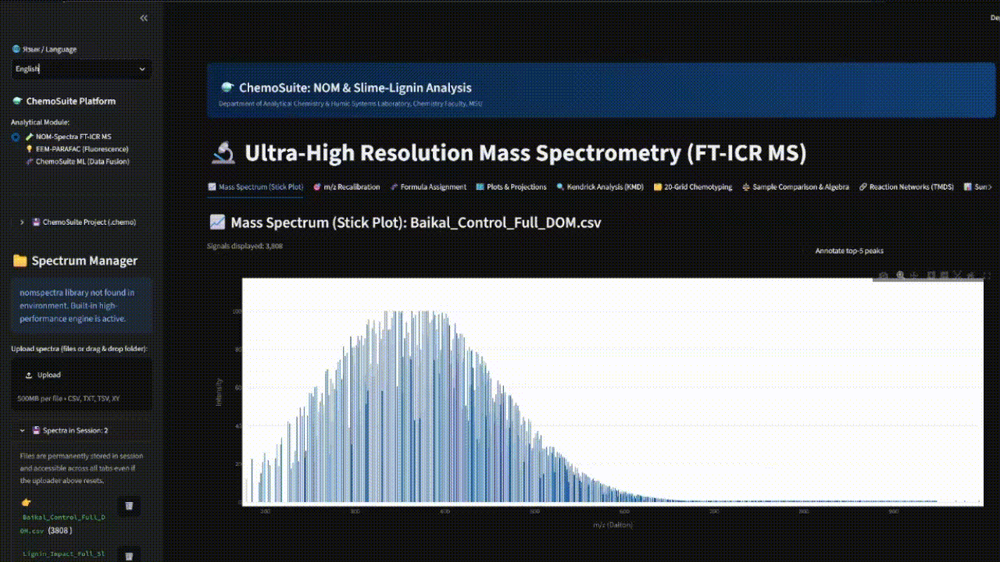

</div>

---

## 📖 About the Platform

Studying complex, polydisperse natural systems requires the parallel application of orthogonal physicochemical methods. **ChemoSuite** brings together ultra-high-resolution mass spectrometry (**FT-ICR MS**), excitation-emission matrix spectrofluorometry (**EEM-PARAFAC**), electronic absorption spectrophotometry (**UV-Vis**), Fourier-transform infrared spectroscopy (**FTIR**), nuclear magnetic resonance spectroscopy (**13C/1H NMR**), thermal degradation analysis (**Py-GC-MS & TGA/DSC**), and size-exclusion chromatography (**SEC / GPC**), coupled with multiblock data integration algorithms (**Low- & Mid-Level Data Fusion + PLS-DA, OPLS-DA, sPLS-DA**) in a single interactive web interface.

The platform addresses a key task in environmental monitoring: reliably distinguishing the background autochthonous organic matter of natural waters from technogenic wood-processing waste (using BPPM sludge lignin in the Lake Baikal ecosystem as a case study).

---

## 🔬 Analytical Modules

| Module | Input Data | Key Methods and Algorithms | Output Analytical Descriptors |
| :--- | :--- | :--- | :--- |
| **🧪 1. FT-ICR MS Studio** | Mass spectrum peak lists (`.csv`, `.tsv`, `.txt`, `.xy`) or **ZIP spectrum archives** | Polynomial mass-scale recalibration, vectorized molecular formula assignment with nitrogen rule and $^{13}\text{C}$ isotopic filtering, TMDS with **interactive molecular reaction network graph** and topological reaction hubs, biogeochemical Van Krevelen polygons, batch archive processing, spectral algebra | $H/C$, $O/C$, $DBE$, $AI$, $NOSC$, biomolecular pools (Lipids, Proteins, Lignin/CRAM, Tannins, CAS), Perminova 20-cell grid, KMD series, topological node degrees $\text{Degree}$ |
| **💡 2. Optical Spectroscopy (EEM & UV-Vis)** | 2D EEM matrices (`.csv`, `.dat`, `.txt`) and 1D UV-Vis spectra (`.csv`, `.txt`) | Delaunay interpolation for Rayleigh scattering removal, Raman normalization (R.U.), non-negative PARAFAC, **CORCONDIA diagnostic**, **Split-Half model validation**, **OpenFluor spectral library matching ($TCC \ge 0.85/0.90$)**, inner filter effect (IFE) correction, Savitzky-Golay filter ($d^1A, d^2A$) | Indices $FI$, $HIX$, fluorophore profiles and contributions $C_1–C_3$, OpenFluor matches ($C_1–C_6$), model stability $TCC$, $A_{254}, A_{280}, E_2/E_3, E_4/E_6, S_R, d^2A_{280}, M_w, \text{SUVA}_{254}$ |
| **🧬 3. ChemoSuite ML** | Fused descriptor matrices across 7 modalities (session or CSV) | **Low-Level Fusion** (block scaling $1/\sqrt{P_k}$) and **Mid-Level Fusion** (PCA compression of FT-ICR MS), **PLS-DA, OPLS-DA and Sparse PLS-DA (sPLS-DA with $L_1$-regularization)**, 95% Hotelling's $T^2$ ellipse, permutation test ($H_0$), S-Plot | Sample classification, $LV_1/LV_2$ projections, $R^2X, R^2Y, Q^2$ metrics, confusion matrix, $p$-value, ranked VIP scores, sparse biomarker panel ($|W|$), and block contribution shares ($\text{VIP}^2$) |
| **🔬 4. FTIR Spectroscopy Studio** | IR spectra (`.csv`, `.dpt`, `.txt`, `.xy`) | AsLS baseline correction, SNV / Vector normalization, Savitzky-Golay filtering ($d^2A$), **carbonyl and double-bond region deconvolution (1500–1800 cm⁻¹)** using Levenberg-Marquardt with Gaussian band profiles, spectral reference library for lignins and polysaccharides (Kraft, Organosolv, Soda, Cellulose, Xylan), lignin indices | Lignin indices $LI, AI, CI$, carbonyl band contributions $A_{1715}, A_{1650}, A_{1595}, A_{1510}$, aromaticity ratio, library match metrics ($r, \text{Score}$) |
| **🧲 5. NMR Spectroscopy Studio** | 1D $^{13}\text{C}$ and $^1\text{H}$ NMR spectra (`.csv`, `.tsv`, JCAMP-DX `.jdx`, `.dx`) | AsLS / polynomial baseline correction, integral binning across 6 standardized IHSS biogeochemical chemical shift ranges ($0–220$ ppm), aromatic region deconvolution ($108–162$ ppm) into syringyl ($S$), guaiacyl ($G$), and $p$-hydroxyphenyl ($H$) lignin subunits, reference IHSS spectra library (Suwannee River, Elliott Soil, Nordic NOM), auto-recalibration via DMSO-d6 ($39.5$ ppm) and TMS ($0.0$ ppm) | Standardized IHSS fractions (Aliphatics, C-O Alkyls, Acetals, Aromatics, Phenolics, Carboxyls), $S/G, H/G$ subunit ratios, aromaticity degree $f_a$, hydrophobic/hydrophilic index $\text{HB/HI}$, IHSS similarity |
| **🌡️ 6. Thermal Analysis Studio (Py-GC-MS & TGA)** | Py-GC-MS TIC / peak tables (`.csv`, `.txt`) and TGA mass loss files (`.csv`, `.txt`) | Flash pyrolysis peak detection and deconvolution, reference biomarker library matching ($H, G, S$ monomers, furans, proteins), Savitzky-Golay smoothed numerical DTG derivative ($-dm/dT$), kinetic thermal zone integration (Zones I–IV) | Pyrolysis ratios $S/G, H/G, L/C, (Ac/Al)_G, (Ac/Al)_S$, Thermal Index $TI = \Delta m_{\text{arom}} / \Delta m_{\text{aliph}}$, $T_{5\%}, T_{10\%}, T_{50\%}$, $T_{max}$ DTG, residue at 800°C |
| **📏 7. SEC / GPC Chromatography Studio** | SEC/GPC chromatograms (`.csv`, `.txt`, `.tsv`) | Universal detector signal processing (UV, RI, dAbs), Asymmetric Least Squares (AsLS) baseline subtraction, multi-standard polynomial calibration (PSS, PEG/PEO, Pullulan), numerical molecular weight distribution calculation ($w(\log M)$ & $W(M)$), 4-fraction ecological partitioning | Number-average $M_n$, weight-average $M_w$, z-average $M_z$, peak $M_p$, polydispersity index $Đ = M_w/M_n$, fraction shares (HMW $>20$ kDa, MHMW $5\text{--}20$ kDa, MMW $1\text{--}5$ kDa, LMW $<1$ kDa), $HMW/LMW$ ratio |

---

## 📸 Screenshots of Analytical Modules and Visualizations

### Module 1: Ultra-High-Resolution Mass Spectrometry (FT-ICR MS)

#### Van Krevelen Plot
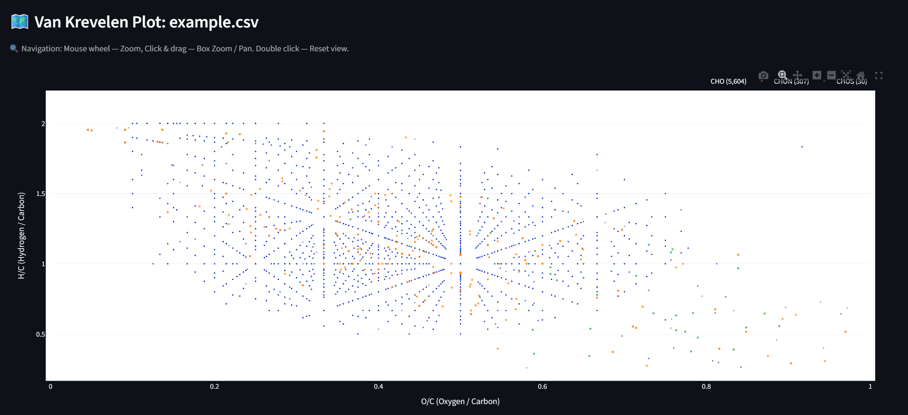

* Molecular mapping of assigned formulas in $H/C$ vs $O/C$ coordinates, differentiated by heteroatom pools ($CHO$, $CHON$, $CHOS$, $CHONS$) and standard biogeochemical classes of natural compounds (Lipids, Peptides/Proteins, Carbohydrates, Lignins/Polyphenols/CRAM, Tannins, Condensed Aromatics CAS, Unsaturated Hydrocarbons) with percentage distribution.

#### Kendrick Mass Defect Analysis (KMD Plot)
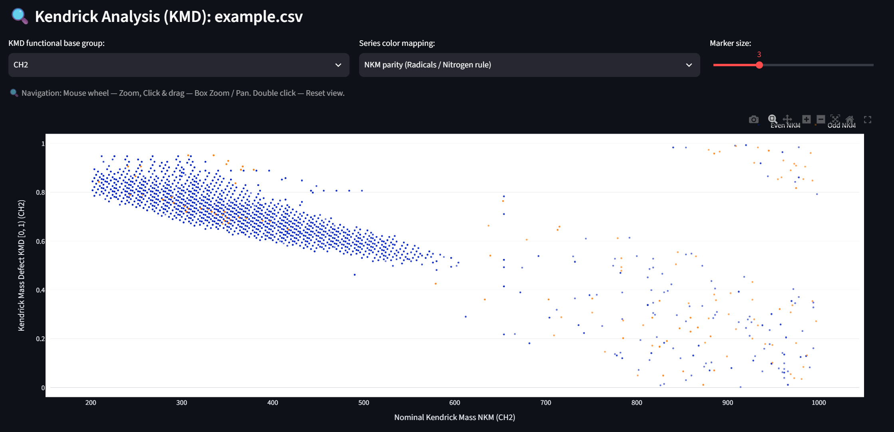

* Identification of homologous series based on the $CH_2$ functional base unit, with color coding by nominal Kendrick mass parity (NKM Parity), separating compounds according to the nitrogen rule.

#### Chemotyping by Perminova's 20-Cell Grid (20-Grid Heatmap)
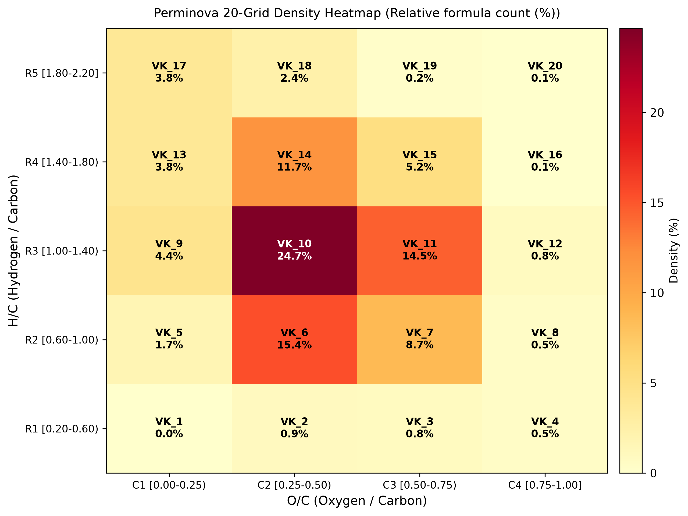

* Digitization of the continuous molecular space of the Van Krevelen diagram into a discrete 20-dimensional feature vector ($VK_1–VK_{20}$) based on the relative number of formulas and intensity-weighted averages.

#### Interactive Reaction Network Graph (TMDS Network Graph)
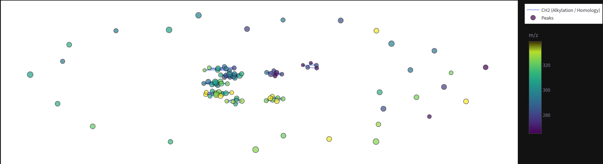

* Topological reaction network mapping transformations between natural and anthropogenic organic molecules along discrete geochemical vectors ($\text{CH}_2$, $\text{O}$, $\text{H}_2\text{O}$, $\text{CO}_2$, $\text{SO}_3$) with identification of key topological reaction hubs and node connectivity degrees ($\text{Degree}$).

---

### Module 2: Optical Spectroscopy (EEM-PARAFAC & UV-Vis)

#### Optical Fluorescence Contour Map (EEM Contour Map)
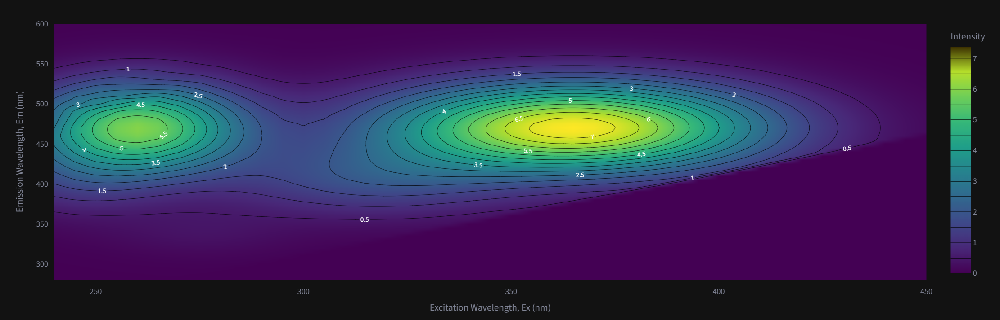

* Interactive 2D visualization of the excitation-emission matrix ($Ex$ 240–450 nm, $Em$ 280–600 nm) in the Viridis palette, after automatic removal of 1st- and 2nd-order Rayleigh scattering with Delaunay interpolation.

#### Spectral Profiles of PARAFAC Components (Loadings B & C)
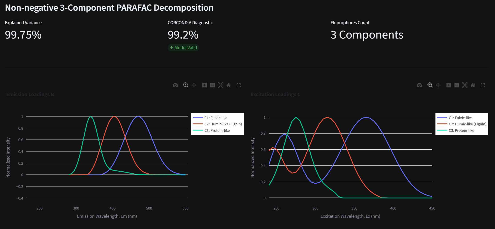

* Decomposition of the three-way fluorescence array into pure-component spectra: emission profiles (Loading B) and excitation profiles (Loading C) for the fulvic-like $C_1$, humic-like $C_2$, and protein-like $C_3$ fluorophores, with model adequacy assessed by CORCONDIA diagnostics.

#### Fluorophore Distribution Across Sample Series (Scores Matrix A)
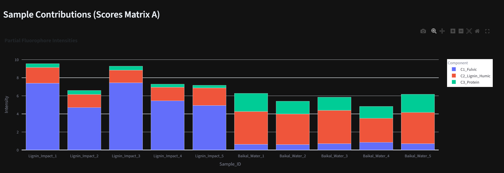

* Comparative monitoring of the relative concentration contributions of fluorophores across the studied sample series, clearly demonstrating the predominance of components $C_1$ and $C_2$ in zones affected by sludge lignin pollution.

#### UV-Vis Spectrophotometry & Inner Filter Effect Correction (Screen 4)
* Interactive absorption spectra inspection $A(\lambda)$ with key reference markers ($A_{254}, A_{280}, A_{365}$).
* Empirical molecular weight estimation via Perminova's equation: $M_w = 3450 - 390 \cdot (E_2/E_3)$.
* Detection of the lignin minimum in the second derivative $d^2A$ at $\sim 280$ nm using Savitzky-Golay filtering.
* Inner Filter Effect (IFE) correction for fluorescence matrices: $F_{\text{corr}} = F_{\text{obs}} \cdot 10^{0.5(A_{\text{ex}} + A_{\text{em}})d}$.
* Computation of spectral slopes $S_{275-295}, S_{350-400}, S_R$ and specific absorbance $\text{SUVA}_{254}$.

---

### Module 3: Multiblock Integration and Machine Learning (Data Fusion, PLS-DA & OPLS-DA)

#### Discriminant Analysis and Marker Selection (PLS-DA, OPLS-DA & VIP Scores)
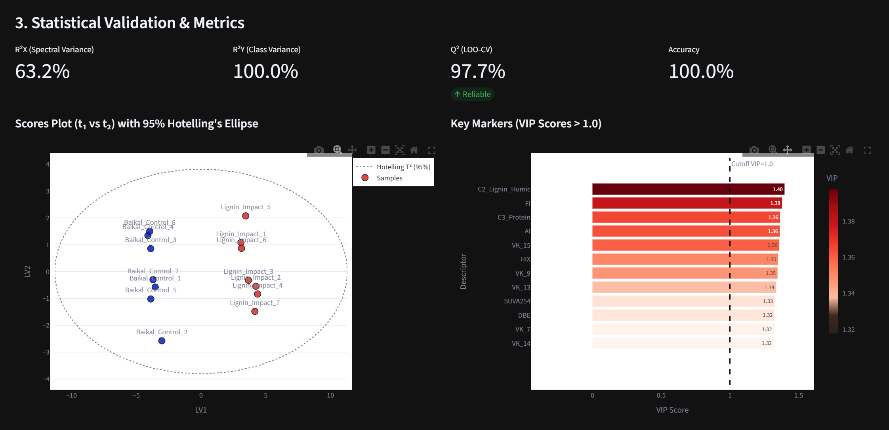

* Multimodal classification model built on the merged descriptor pool of all analytical modalities (**FT-ICR MS + EEM-PARAFAC + UV-Vis + FTIR + NMR + Thermal Analysis**).
* **PLS-DA & OPLS-DA Architectures:** standard PLS-DA and orthogonal OPLS-DA (Orthogonal PLS-DA) separating predictive variation ($t_{\text{pred}}$) from orthogonal noise ($t_{\text{ortho}}$).

#### 3D Latent Scores Space & 95% Hotelling's Ellipsoid (Scores Plot 3D)
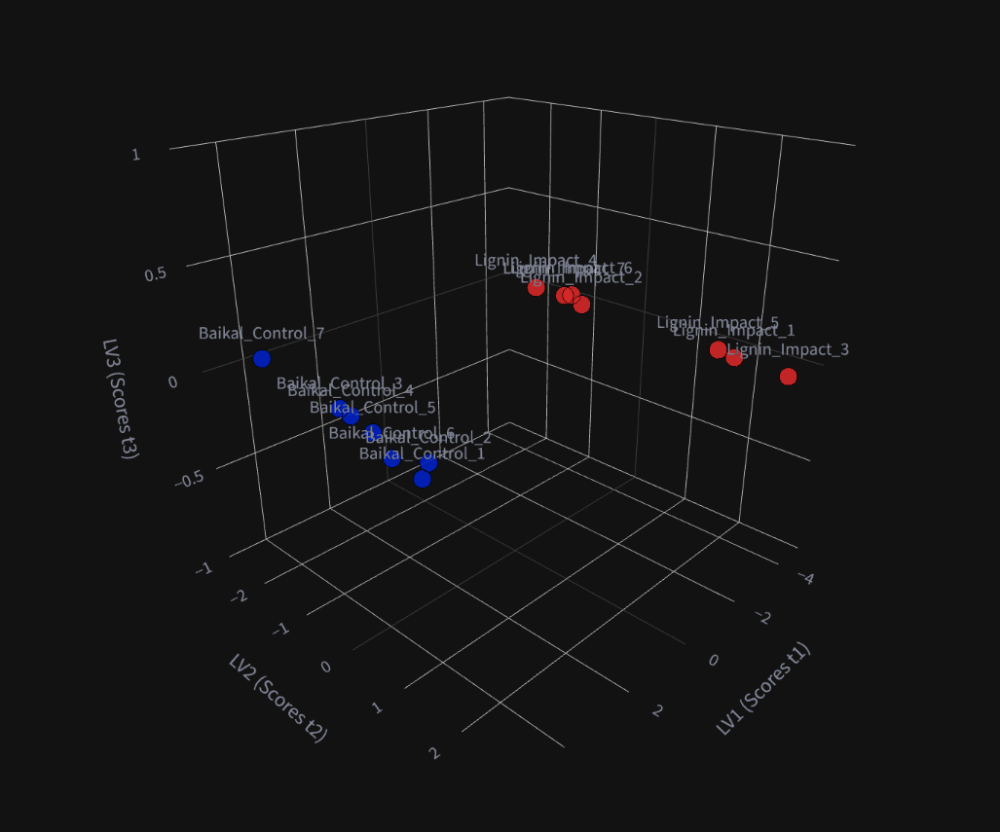

* Interactive three-dimensional latent score space ($LV_1 \times LV_2 \times LV_3$) featuring a parametric 95% Hotelling's $T^2$ confidence ellipsoid surface, cleanly segregating pristine Lake Baikal samples from industrial kraft sludge-lignin.

#### Multiblock Biomarker Ranking (VIP Scores Barplot)
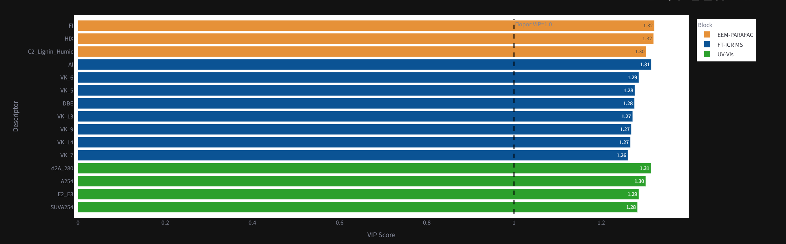

* Multifactorial ranking of discriminative predictors ($VIP > 1.0$) with color-coded analytical source tagging (blue: FT-ICR MS, orange: EEM-PARAFAC, green: UV-Vis, purple: FTIR, teal: NMR, red: Thermal).

* **S-Plot Diagram (OPLS-DA):** covariance $p[1]$ (magnitude) vs correlation $p(\text{corr})[1]$ (reliability) visualization for biomarker discovery with block color tags.
* **Validation & Diagnostics:** Leave-One-Out / K-Fold cross-validation ($Q^2$) and permutation testing (50 iterations) with empirical $p$-value.
* **Comprehensive Analytical Passport (.xlsx):** export multi-sheet styled Excel report containing metadata summary, fused feature matrix, all modality indices, VIP biomarkers, and S-Plot.
* **Save & Restore Projects (.chemo):** package full analytical workspace session (spectra, optical descriptors, fused matrix, trained models) into a portable compressed project file and restore workspace state in one click.

---

## 📂 Project Structure

```text
ChemoSuite/
│
├── app.py                            # Main super-app: Streamlit UI routing, 6-modal dashboards, and session assembler
│
├── modules/                          # 🧠 Computational and chemometric engines
│   ├── __init__.py                   # Package initialization and module exports
│   ├── fticr_core.py                 # Mass spec core: formulas, 13C isotopes, KMD, 20 cells, TMDS networks, vector fluxes
│   ├── eem_core.py                   # Optical core: EEM filters, PARAFAC tensors, UV-Vis parser, IFE, derivatives, indices
│   ├── chemo_ml.py                   # Chemometric core: Low/Mid Fusion, PLS-DA, OPLS-DA, sPLS-DA, 3D Hotelling, S-Plot, permutation
│   ├── chemo_pubchem.py              # Chemoinformatics: PubChem PUG-REST API, ChEMBL, HMDB, 2D structures, offline library
│   ├── ftir_core.py                  # FTIR core: AsLS, C=O/C=C deconvolution, lignin library, spectral indices
│   ├── nmr_core.py                   # NMR core: AsLS, IHSS integrals, S/G/H deconvolution, auto-recalibration
│   ├── thermal_core.py               # Thermal core: Py-GC-MS peak detection, reference library, TGA/DTG derivatives, zones I-IV
│   ├── project_io.py                 # .chemo project manager: serialization, ZIP compression, session restore
│   └── report_generator.py           # Analytical report generator (.xlsx) in Russian & English styled with openpyxl
│
├── demo_data/                        # Synchronized multimodal demo data (EEM, UV-Vis, FT-ICR MS, FTIR, NMR, Thermal, ML)
│   ├── eem/                          # 12 excitation-emission fluorescence matrices
│   ├── uv_vis/                       # 12 UV-Vis absorption spectra (200–700 nm)
│   ├── fticr_ms/                     # 4 high-resolution mass spec peak lists + sample_A_full.csv
│   ├── nmr/                          # 12 synthetic 13C NMR reference standards & descriptor matrix
│   ├── thermal/                      # 12 synthetic Py-GC-MS & TGA reference pairs & descriptor matrix
│   ├── multimodal_ml/                # Summary descriptor tables (block-wise and unified matrix)
│   └── README.md                     # Guide on using demo files
│
├── tests/                            # Automated test suite (94 unit and stress tests)
│   ├── test_fticr.py                 # Mass spectrometry tests (formulas, KMD, 20 cells, TMDS networks, vector fluxes, pathways)
│   ├── test_chemo_pubchem.py         # PubChem chemoinformatics tests (PUG-REST, formula cleaning, biomarker annotation)
│   ├── test_eem_uv.py                # Optical spectroscopy tests (EEM, scatter removal, UV-Vis, IFE)
│   ├── test_chemo_ml.py              # Chemometrics tests (Data Fusion, PLS-DA, OPLS-DA, sPLS-DA, 3D Ellipsoid, S-Plot)
│   ├── test_ftir.py                  # FTIR tests (AsLS, deconvolution, lignin indices, library)
│   ├── test_nmr.py                   # NMR tests (IHSS integrals, S/G/H deconvolution, auto-recalibration, JCAMP-DX)
│   ├── test_thermal.py               # Thermal tests (Py-GC-MS library match, TGA/DTG derivatives, zones I-IV, indices)
│   ├── test_demo_pipelines.py        # End-to-end integration tests for demo data (FT-ICR, EEM, UV-Vis, ML)
│   ├── test_report_generator.py      # Multi-sheet Excel passport generation tests (.xlsx)
│   ├── test_project_io.py            # Session serialization & restoration tests (.chemo)
│   └── test_unusual_stress_cases.py  # Stress testing under adversarial and boundary conditions (singular PLS, noise, edge cases)
│
├── .github/workflows/ci.yml          # GitHub Actions CI pipeline (Ubuntu/Windows, Python 3.10-3.12)
├── pytest.ini                        # Pytest configuration file
├── assets/                           # Screenshots and graphics for the README
├── user_spectra/                     # Local storage for uploaded mass spectra (in .gitignore)
├── requirements.txt                  # Project dependencies (streamlit, tensorly, scikit-learn, openpyxl, pytest)
├── .gitignore                        # System and temporary file exclusions
├── README.md                         # Main repository documentation on GitHub (English default)
├── README_RU.md                      # Platform documentation (Russian)
└── README_EN.md                      # Platform documentation (English)
```

---

## 🚀 Quick Start

### 1. Clone Repository
```bash
git clone https://github.com/xav1c34/ChemoSuite.git
cd ChemoSuite
```

### 2. Configure Virtual Environment
**Windows (PowerShell):**
```powershell
python -m venv .venv
.venv\Scripts\Activate.ps1
```

**Linux / macOS:**
```bash
python3 -m venv .venv
source .venv/bin/activate
```

### 3. Install Dependencies
```bash
pip install --upgrade pip
pip install -r requirements.txt
```

### 4. Run Automated Test Suite
```bash
pytest -v tests
```

### 5. Launch Web Application
```bash
streamlit run app.py
```

Once launched, the interface will open automatically in your browser at `http://localhost:8501`.

---

## 📦 Input Data Formats

* **Mass spectrometry (FT-ICR MS):** text files containing peak lists (`.csv`, `.tsv`, `.txt`, `.xy`). At least two numeric columns are required: experimental mass ($m/z$) and peak intensity/height.
* **Fluorometry (EEM):** 2D fluorescence matrix tables (`.csv`, `.dat`, `.txt`) in which rows correspond to emission wavelengths ($Em$) and columns to excitation wavelengths ($Ex$), or vice versa; the parser detects orientation automatically.
* **Spectrophotometry (UV-Vis):** 1D absorption spectrum tables (`.csv`, `.txt`, `.tsv`) with wavelength ($\lambda$, 200–800 nm) and absorbance ($A$) columns.
* **Infrared spectroscopy (FTIR):** 1D transmission or absorbance spectra (`.csv`, `.dpt`, `.txt`, `.xy`) spanning wavenumbers $400–4000\text{ cm}^{-1}$.
* **NMR spectroscopy (NMR):** 1D $^{13}\text{C}$ and $^1\text{H}$ NMR spectra (`.csv`, `.tsv`, `.txt`, `.xy`, JCAMP-DX `.jdx`, `.dx`) across chemical shift ranges $\delta$ ($0–220$ ppm).

---

## 🏷️ Version History

* **`v1.0.0-fticr`**: Standalone version of the NOM-SPECTRa ultra-high-resolution mass spectrometry studio.
* **`v2.0.0`**: Integration of 3D EEM-PARAFAC spectrofluorometry, a multiblock descriptor fusion module (Data Fusion), and PLS-DA discriminant analysis.
* **`v2.1.0` (ChemoSuite Trimodal)**:
  * Full trimodal integration: **FT-ICR MS + EEM-PARAFAC + UV-Vis**.
  * UV-Vis spectrophotometry module: calculation of $A_{254}, A_{280}, E_2/E_3, S_R$, Perminova $M_w$ estimation, derivative spectroscopy ($d^2A_{280}$), and inner filter effect (IFE) correction.
  * Advanced data fusion strategies: Low-Level (block scaling $1/\sqrt{P}$) and Mid-Level Fusion (PCA compression of FT-ICR MS).
  * PLS-DA diagnostics & validation: permutation test with empirical $p$-value, confusion matrix, sensitivity/specificity, and analytical block contribution weights ($\text{VIP}^2$).
  * Active session assembler: automatic merging of descriptors from Modules 1 and 2 into Module 3.
  * Modular core architecture: separated computational engines (`fticr_core.py`, `eem_core.py`, `chemo_ml.py`) and UI (`app.py`).
  * Comprehensive 18-unit test suite (`pytest`) and GitHub Actions automated CI/CD pipeline.
* **`v2.2.0` (ChemoSuite LTS / Full Trimodal & Chemoinformatics Release)**:
  * Orthogonal OPLS-DA and sparse sPLS-DA algorithms ($L_1$-LASSO regularization with biomarker selection).
  * Expanded chemoinformatics: direct 2D chemical structure rendering and cross-database queries for PubChem, ChEMBL, and HMDB.
  * Complete bilingual localization i18n (RU/EN) across all modules, tabs, graphs, dialogs, and reports.
  * Formatted multi-sheet Excel passport exports (.xlsx) styled with openpyxl and language switching.
  * Project workspace manager (`.chemo` session archives) with complete state serialization and 1-click recovery.
  * Full stress testing suite with 63 unit/integration tests.
* **`v3.0.0-dev` (ChemoSuite 5-Modal / FTIR & NMR Spectroscopy Studio)**:
  * Complete 5-modal integration: **FT-ICR MS + EEM-PARAFAC + UV-Vis + FTIR + 13C/1H NMR**.
  * Module 4 (FTIR): carbonyl region deconvolution (1500–1800 cm⁻¹), lignin & cellulose spectral library, and lignin indices.
  * Module 5 (NMR): 13C/1H NMR IHSS chemical shift binning, aromatic region deconvolution into S/G/H lignin subunits, IHSS reference library, auto-recalibration.
  * 5-block Data Fusion in ChemoSuite ML and export of all 5 modalities to `.chemo` project files and multi-sheet Excel passports.
  * Expanded test suite with 86 unit and adversarial stress tests (`pytest`).

---

## 👥 Authorship and Development

The algorithms, computational core, and software suite are developed by:

* **T. O. Bay** (Bay, T. O., 2026) — concept, architecture, computational pipelines, and web interface

---

## 📜 Citation

If you use **ChemoSuite** in your academic research or environmental monitoring studies, please cite our software platform:

```bibtex
@software{chemosuite2026,
  author       = {Bay, T. O.},
  title        = {{ChemoSuite: Multimodal Chemometrics Platform for Natural Organic Matter and Lignin Analysis}},
  year         = {2026},
  publisher    = {GitHub},
  version      = {v3.0.0-dev},
  url          = {https://github.com/xav1c34/ChemoSuite},
  note         = {Web Application: https://nom-spectra.streamlit.app/}
}
```